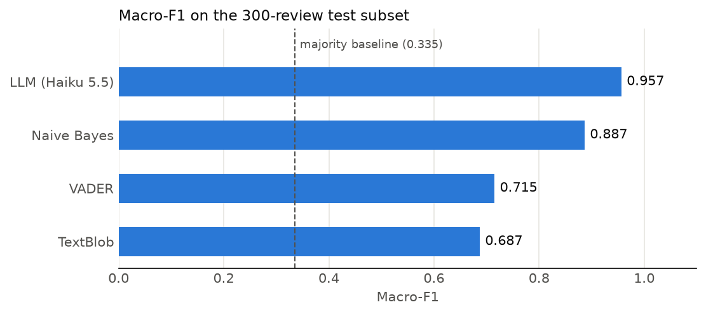
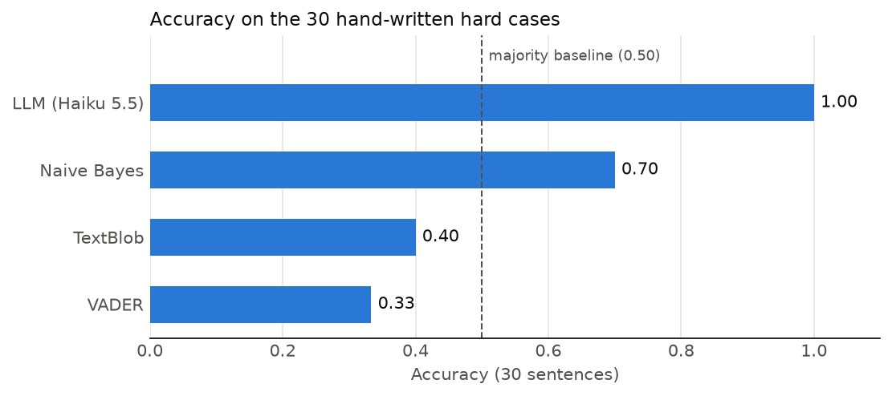

# Sentiment Analysis from Classic NLP to LLMs

**Milestone 4 report** · November 2026

## 1. Task and question

The task is to classify movie reviews as **positive** or **negative** with three approaches of increasing sophistication, and compare them on accuracy, speed and cost:

1. **Rule-based:** a sentiment lexicon with no training (VADER; TextBlob as a second lexicon).
2. **Classic ML:** TF-IDF features with a Naive Bayes classifier, trained on labelled data (NLTK + scikit-learn).
3. **LLM:** a zero-shot prompt to Claude Haiku 5.5, with no training and no examples.

The guiding question is: *when is a simple model good enough, and when does an LLM earn its cost?*

## 2. Dataset and evaluation setup

**Data.** The IMDB Large Movie Review Dataset (Maas et al., 2011) has 50,000 reviews, split evenly between positive and negative. Labels come from the reviewer's star rating, not from reading the text. Cleaning removed HTML tags and 422 duplicate reviews, leaving 49,578. Reviews are long: 229 words on average, median 171, up to 2,459. Length is almost identical across the two classes, so it carries no signal by itself.

**Splits, fixed once.** A stratified 80/20 split with seed 42 gave 39,662 training reviews and a held-out pool. From that pool I drew a **stratified test subset of 300 reviews** (149 negative / 151 positive). Every model is scored on exactly this subset. Duplicates were removed *before* splitting so that no review appears in both sets. EDA used the training set only. A hash manifest makes the notebooks refuse a modified split.

**Hard cases.** I also wrote 30 short sentences (15 positive / 15 negative) covering 12 known failure modes before running any model. The modes are negation, double negatives, sarcasm, contrast ("…but…"), dark plot summaries in positive reviews, domain-specific polarity ("unpredictable", "terrifying"), comparisons, faint praise, idioms, slang and emoji, rhetorical questions, and numeric ratings.

**Metrics.** Accuracy and **macro-F1** (the main metric) on the test subset, a confusion matrix per model, accuracy on the hard cases, seconds per 1,000 predictions, and dollars per 1,000 predictions. One shared function scores every model, so all tiers are measured the same way.

## 3. How each tier works

**Tier 1: VADER (rule-based).**
- VADER looks up each word in a hand-built lexicon of sentiment scores. It adjusts for negation ("not good"), intensifiers ("very"), capitals, exclamation marks and "but", and returns a compound score from −1 to +1.
- Since the task has two classes, a review is positive if compound ≥ 0.
- Nothing is learned. I swept the threshold on 2,000 *training* reviews: moving it to 0.75 would add about 3 points, but I kept 0 so Tier 1 stays truly training-free.
- TextBlob, scored the same way, is a second rule-based reference.

**Tier 2: TF-IDF + Naive Bayes (classic ML).**
- **Preprocessing (NLTK):** the text is tokenised with `TweetTokenizer`, which lowercases and keeps emoji. English stopwords are removed, except negations such as "not", "no" and "don't".
- **Model:** `TfidfVectorizer` turns each review into weighted word and two-word-phrase counts, and multinomial Naive Bayes learns how likely each feature is under each class.
- **Tuning:** a grid search with 5-fold cross-validation on the training set only picked unigrams + bigrams, `min_df = 2` and smoothing `alpha = 0.3`. That is 537K features, with a CV macro-F1 of 0.894.
- **Negation marking didn't help:** NLTK's `mark_negation` (tagging words after a negation as `good_NEG`) scored 0.892, within noise, so it was dropped. Bigrams already capture "not bad" and "don't waste".

**Tier 3: Claude Haiku 5.5, zero-shot (LLM).**
- **Prompt:** the system prompt asks for the reviewer's overall opinion of the film. I kept it deliberately minimal, with no hints about sarcasm or plot summaries. The other tiers got no such help, and naming the hard-case patterns would inflate their score.
- **Output:** a JSON schema restricts the answer to `{"label": "positive" | "negative"}`, so every response parsed. Thinking is off.
- **Development:** the prompt and settings were tried only on 40 training reviews (39 correct; adaptive thinking gave no gain), then frozen.
- **Cache:** all 330 test-time responses are saved with token counts, latency and cost. That file is the cost and latency log, and it makes re-runs free and exactly reproducible.

## 4. Results

| Model | Accuracy | Macro-F1 | Hard-cases acc. | Sec / 1k preds | Cost / 1k preds |
|---|---|---|---|---|---|
| Majority baseline | 0.503 | 0.335 | 0.50 | <0.1 | $0 |
| VADER | 0.727 | 0.715 | 0.33 | 4.7 | $0 |
| TextBlob | 0.710 | 0.687 | 0.40 | 2.1 | $0 |
| NLTK + Naive Bayes | 0.887 | 0.887 | 0.70 | 4.2 | ~$0 |
| **LLM zero-shot (Haiku 5.5)** | **0.957** | **0.957** | **1.00** | 1,560 | $0.075 |

*Speed is measured on a laptop CPU; local timings vary by about ±30% between runs. For the LLM it is the mean API latency with requests made one at a time; four parallel requests cut it to about 390 s per 1,000. Naive Bayes training plus the grid search took 12–15 minutes once. The whole LLM test run cost $0.024.*

**Each step up is real.** On 300 reviews, a 7-point gap could be luck, so I compared models with an exact McNemar test, which uses only the reviews where two models disagree.
- Naive Bayes fixes 69 of VADER's errors and introduces 21 (p = 4×10⁻⁷).
- The LLM fixes 29 of Naive Bayes's 34 errors and introduces 8 (p = 0.0008).

**The models are biased differently.** The lexicons call 70% (VADER) and 77% (TextBlob) of reviews positive on a 50/50 test set. VADER labels 47% of negative reviews as positive, because even bad reviews praise an actor, a score or another film, and over 230 words those positive words add up. Naive Bayes and the LLM are balanced, predicting about 49% positive.

## 5. Error analysis

**Errors are nested.**
- 193 of 300 reviews (64%) are correct for all three tiers, and **no review is wrong for all three**.
- 65 errors are VADER's alone. These are mostly long negative reviews that any trained model handles.
- Only 4 errors are the LLM's alone.

**Length works in opposite directions.**

| Accuracy | Short (36–136 words) | Medium (137–214) | Long (219–980) |
|---|---|---|---|
| VADER | 0.82 | 0.76 | 0.60 |
| Naive Bayes | 0.85 | 0.92 | 0.89 |
| LLM | 0.93 | 0.96 | 0.98 |

VADER gets *worse* as reviews get longer, because its positive bias accumulates. The LLM gets *better*, because more text means more evidence of the reviewer's verdict.

**Hard cases by category** (heatmap: `results/charts/compare_hard_case_categories.png`).
- **Lexicons fail on anything non-literal.** VADER scores 0% on sarcasm, slang/emoji, idioms, double negatives and dark plot summaries. "The lead actress absolutely killed it" scores −0.70 and "this movie is sick 🔥🔥" scores −0.85. Its negation rule does work: it gets 3 of 3 simple negations.
- **Naive Bayes learned many of these from data:** sarcasm, faint praise, domain polarity and dark plot summaries are all 100%. All 9 of its misses are short *positive* sentences with one negative-leaning word, such as "acting was wooden… but somehow I loved every minute" (P(positive) = 0.10). A bag of words can't tell which side of "but" carries the verdict.
- **The LLM got all 30 right.**

**Where the LLM beats Naive Bayes** (29 reviews): the verdict depends on how the clauses relate. Examples are "Neither the total disaster… nor the misunderstood masterpiece…", "The photography is accomplished, the acting is quite good, but… a dreary bore", a rating stated in words ("I gave this a 7"), and positive reviews that spend most of their words complaining.

**What the LLM gets wrong** (13 reviews). Reading them, many are arguably label noise rather than model failure:
- **The text contradicts the star rating:** "loved it in 1973… sorry to say it doesn't hold up" is labelled positive; "I felt unsatisfied… I came to find it lacking" is labelled positive.
- **"So bad it's good":** "If you enjoy the very worst of the worst, this is for you" is an ironic recommendation with a low rating.
- **Grim subject, positive verdict:** "A truly scary film" about oil depletion is labelled positive.
- **Reviews that aren't about the film:** for example, a complaint that a show was cancelled.

At 95.7% the LLM is probably close to the ceiling set by these labels.

**Caveats.**
1. **The hard cases favour the LLM.** They were written by an LLM, so they are short, unambiguous and in a style close to its own writing. They are good for comparing failure modes, but 30/30 does not mean the LLM never fails on sarcasm. The real-review errors above show it can.
2. **Haiku may already know these reviews.** IMDB is public and likely in its pretraining data, so zero-shot accuracy on an unseen domain may be lower.
3. **300 reviews is small.** The 95% confidence interval on each accuracy is about ±2–5 points. That is why the paired McNemar test, not the raw gap, supports the ranking.

## 6. Conclusion: which model when

| Volume: 1M reviews | Time | Cost |
|---|---|---|
| Naive Bayes, one laptop CPU | about 70 minutes | $0 |
| LLM, requests one at a time | about 18 days | $75 |
| LLM, 4 parallel requests | about 4.5 days | $75 |

**The LLM's real cost is time and dependency, not money.** At $0.075 per 1,000 reviews, Haiku 5.5 is cheap. What it costs is roughly 370× the latency of a local model, plus a network and rate-limit dependency. For offline jobs, the Batch API halves the price and removes concurrency management.

**Use Naive Bayes (or another classic model) when:**
- labelled in-domain data exists;
- volume is high or latency matters (live dashboards, streams, on-device);
- about 89% accuracy is acceptable, for example when tracking aggregate trends where individual errors average out.

It trains in minutes, predicts in milliseconds, costs nothing and runs offline.

**Use the LLM when:**
- there is no labelled data, or the domain is new, since it needs zero training examples;
- the text is nuanced (contrast, sarcasm, mixed verdicts);
- individual decisions matter, such as escalating a customer complaint or moderating content.

Here it cut errors by 62% (34 → 13) for $0.075 per 1,000 reviews.

**Use VADER only** as a zero-setup baseline or for short, literal text. On these reviews it recognises barely half of the negative ones (53% recall), and its accuracy falls to 0.60 on the longest third.

**A practical hybrid** follows from the nested errors: run Naive Bayes on everything and send only low-confidence predictions to the LLM. That would keep most of the LLM's accuracy at a fraction of its latency. Testing it is the natural next step.

---

*Reproducibility: all code, frozen splits, cached LLM responses and per-example predictions are in the repository; see the README for how to run the five notebooks.*
